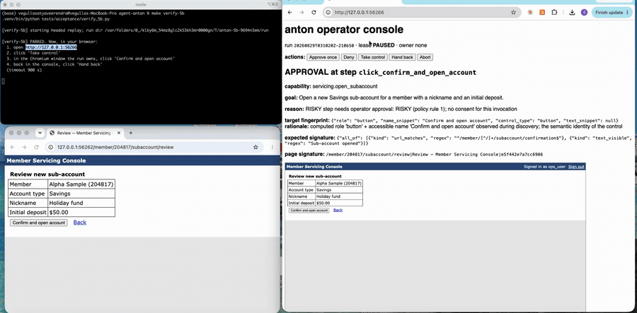

# anton — a digital back-office operator

anton learns a browser flow once and replays it exactly: a model discovers a legacy back-office UI, the
run is distilled into a **typed, reviewable capability artifact**, and from then on the artifact replays
**deterministically with no model in the loop** — with a policy gate in front of every action, redaction at
every sink, a closed set of business outcomes, and a human escalation path (lease, operator console,
takeover, hand-back) when the run cannot continue on its own.

The demo target is a deliberately hostile "Member Servicing Console" (nested tables, an iframe pane, two
tenants, injectable failures) that ships in this repo. Everything is synthetic; see *Fake credentials* below.

## Setup

```bash
python3.12 -m venv .venv && . .venv/bin/activate      # requires Python 3.11+. If `python3.12` is not on your PATH, substitute
                                                       # whichever 3.11+ binary you have, e.g. `python3.11 -m venv .venv` or
                                                       # `python3 -m venv .venv` — but only if `python3 --version` prints 3.11 or newer.
pip install -r requirements.txt
playwright install chromium
cp .env.example .env                                   # a key is needed ONLY for `anton discover`; see "Discover your own artifact" below
```

`.env` is gitignored and loaded automatically by `python -m anton …`; real environment variables always
win. `ANTON_MODEL` defaults to `claude-sonnet-5`. Every **new terminal** you open needs
`. .venv/bin/activate` before any `python -m anton …` command; the `make …` targets do not (the Makefile
runs the venv's Python directly).

## The demo path (in order) — no API key needed

Every command below is a thin wrapper over `python -m anton …`. Two **approved, discovered** artifacts are
committed (`artifacts/read_savings_balance.json`, `artifacts/open_subaccount.json`, both distilled from real
model runs whose evidence is in `evidence/`), so this whole sequence runs without a key. Replays open a
visible Chromium window that drives itself — do not click into it; it closes when the run ends.

Start the app in one terminal and leave it running:

```bash
make target                                  # 1. serve the Member Servicing Console on http://localhost:8000  (TENANT=beta INJECT=expire,modal …)
```

It is up when `http://localhost:8000/login` answers in your browser, about a second after the command
starts. Then, in a second terminal (`. .venv/bin/activate` first):

```bash
make replay                                  # 2. deterministic replay of the committed artifact: exit 0, typed outputs   (MEMBER=310552 for another member)
make replay-notfound                         # 3. error replay: BUSINESS_OUTCOME MEMBER_NOT_FOUND — an outcome, not a crash
python -m anton replay artifacts/open_subaccount.json \
  --param member_id=204817 --param initial_deposit=50 --param nickname="Holiday fund"        # 4. risky step → BLOCKED(APPROVAL_REQUIRED), exit 40
python -m anton replay artifacts/open_subaccount.json \
  --param member_id=204817 --param initial_deposit=50 --param nickname="Holiday fund" \
  --approve-risky --outputs-file /tmp/out.json                                               # 5. risky step approved by the caller → SUCCESS; raw output only in the 0600 file
```

At step 3 the terminal ends with `make: *** [replay-notfound] Error 10`: exit code 10 is the documented
`BUSINESS_OUTCOME` code (the member does not exist), `make` merely reports the non-zero exit — this is the
demo behaving correctly, not a failure.

Other things worth trying: `make replay-beta` (the alpha-recorded artifact on tenant beta through
`overlays/beta.yaml`, with `make target TENANT=beta`), and escalation:
`python -m anton replay artifacts/open_subaccount.json … --escalate` parks at the risky step and prints the
operator console URL (default `http://127.0.0.1:7071`, `--console-port` to change it; note macOS AirPlay
occupies 5000/7000) — Approve once / Deny / Take control / Hand back / Abort.

Every run writes `runs/<run_id>/` (`run.jsonl` through the Redactor, `result.json` redacted view, masked
screenshots, redacted page snapshots on failure). Exit codes are a pure function of the result: `0`
SUCCESS · `10` BUSINESS_OUTCOME · `20` FAILED · `30` FAILED/POLICY_VIOLATION · `40` BLOCKED · `2` usage.

## Discover your own artifact — requires an API key

This is the model-driven half: a goal in, a draft artifact out, then the same review → approve → replay
path. Put your key in `.env` (the file you copied in Setup):

```bash
# in .env: set the line   ANTHROPIC_API_KEY=<your key>     (the file is gitignored; nothing else in it needs changing)
```

With `make target` still running in its own terminal, in the activated second terminal:

```bash
make discover OUT=runs/demo                  # 6. discover the balance capability  →  runs/demo/read_savings_balance.json (draft)
                                             #    (OUT defaults to artifacts/, which would overwrite the committed, evidence-linked approved artifact;
                                             #     `git checkout artifacts/` restores it)
python -m anton inspect runs/demo/read_savings_balance.json   # 7. review the contract: inputs, outputs, closed outcome space, every locator + rationale
python -m anton approve runs/demo/read_savings_balance.json   # 8. draft → approved (content-hash bound; any later edit invalidates it)
python -m anton replay runs/demo/read_savings_balance.json --param member_id=204817   # 9. deterministic replay of what you just discovered
```

`make discover-subaccount` does the same for the risky sub-account goal (with `--approve-risky`).

## Call it from Python

```python
from anton.api import invoke

result = invoke("artifacts/read_savings_balance.json", {"member_id": "204817"}, url="http://localhost:8000")
print(result.status, result.outputs)          # SUCCESS {'savings_balance': 19823.28}
```

`invoke(...)` takes the same options as the CLI (`overlay`, `policy`, `approve_risky`, `allow_draft`,
`escalate`, `outputs_file`, …) and returns the redacted `ReplayResult`.

## No API key?

Everything except `discover` works without one: run the demo path above (steps 1–5, all on the committed
artifacts) and every automated gate:

```bash
make verify-all          # unit + surface + AW-1, 1b, 2, 3, 4, 5a, 6, 7 + the evidence scan; then reminders for the two human gates
make verify-5b           # AW-5b, the human round-trip (take control → click Confirm in the live window → hand back)
```

`make verify-all` spawns its own copies of the app on free ports; it does not need `make target` running.

## Fake credentials

The target app's operator login is `ops_user` / `demo-pass-1` — a fake demo credential seeded in
`target_app/data.json`. Replay never types it as a literal: the login flow uses `SecretRef("DEMO_PASSWORD")`,
resolved at act-time from `ANTON_SECRET_DEMO_PASSWORD` (set in `.env.example`); the model never sees it
(discovery logs in through the replay engine before the first turn). Every SSN, date of birth and account
number in the seed is synthetic (`900-XX-XXXX` is an invalid SSN range) and is scrubbed from every log,
snapshot and transcript, and masked in every screenshot; `make verify-evidence` proves the absence from every
file under `evidence/`, `artifacts/` and `runs/` (text files line by line, binaries by byte scan), and AW-4
additionally byte-scans the screenshots of a failing run.

## See it

The human hand-off (AW-5b): the replay parks at the risky step, the operator takes control in the console,
clicks "Confirm and open account" in the live Chromium window, hands back, and the run resumes to SUCCESS.



Full-resolution clip: [`evidence/escalation-demo/aw5b-roundtrip.mp4`](evidence/escalation-demo/aw5b-roundtrip.mp4) (36 s, silent).

## Where to look

- `evidence/INDEX.md` — every evidence folder mapped to the acceptance workflow or gate it demonstrates (discovery runs with transcripts, the escalation demos, one replay folder per AW).
- `SPEC.md` — the contract the code was built to; `REPORT.md` — the design write-up; `docs/decisions.md` — every judgment call, one line each.
- `anton/schema/artifact.py` — the artifact schema (the centerpiece); `anton/policy/` — the gate and the Redactor; `anton/replay/engine.py` — the deterministic executor; `anton/escalation/` — lease, console, recorder.
