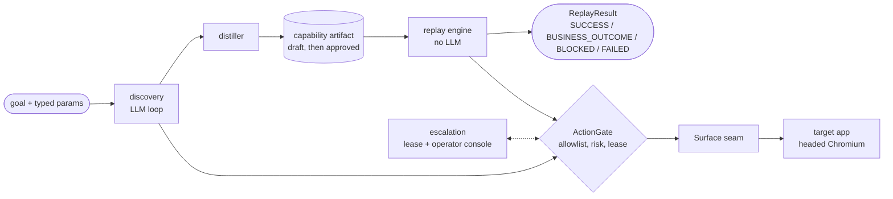
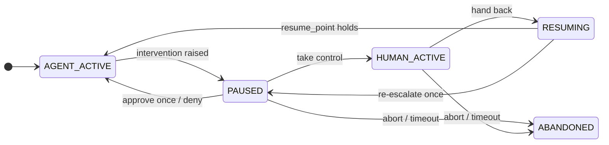

# REPORT

## 1. Architecture

anton is a single-process pipeline with one seam and one choke point. An LLM **discovers** a flow against a live legacy UI once; the run is **distilled** into a typed capability artifact; from then on the artifact **replays with no model in the loop** (a unit test asserts the replay package imports neither `anthropic` nor the discovery code). When replay cannot safely continue, it **escalates**: the run parks, a human operates the same live browser session, and the engine re-localizes and continues. Every action from discovery or replay passes one `ActionGate` before it reaches the browser, and every byte written to disk or stdout passes one `Redactor`.

The seam is the `Surface` protocol: `observe()` returns a redacted semantic snapshot (computed roles, accessible names, text, bounding boxes, per frame); `act()`, `read()` and `screenshot()` each do one thing, and screenshots fail closed. Only the Playwright implementation exists, and locators resolve over snapshot geometry, never the DOM. Two decisions shaped the rest. First, the target app is part of the design: a deliberately hostile Flask "Member Servicing Console" with nested tables, an iframe detail pane, no ids or test IDs, server-side validation, five injectable runtime failures and two tenant variants; every acceptance test drives the real CLI against a freshly spawned copy, and nothing in the verified path is mocked. Second, I built replay before discovery: the engine and two hand-authored artifacts came first, forcing the schema to be a contract replay actually needs rather than whatever a model emits. When discovery landed, the same acceptance suite passed the distilled artifacts unmodified.

## 2. Artifact schema

An artifact is a contract, not a macro. A calling agent reads from it what state it needs (`preconditions`, established by named profile flows such as `login`), what to send (typed `inputs`), what comes back (typed, coerced `outputs`), and every outcome it can produce: `business_outcomes` is a closed space, and the loader refuses an artifact whose reachable detectors emit an undeclared code. A human reviews the same file through `anton inspect`. Every polymorphic field is a discriminated union, so the JSON schema is itself reviewable and an unknown field is an error, not noise.

Checkpoints are signatures, not hope: every step asserts a `StateSignature`, and `FILL`/`SELECT` steps must assert their own field's value. Element identification is a three-tier locator ladder, each candidate carrying a written rationale. Tier 1 is computed role plus accessible name. Tier 2 is a relation over snapshot geometry only: `right_of_label`, `below_label`, or `row_cell` (row anchored by content, column found by header), which is what survives a column reorder. Tier 3 is a normalized bounding box. A per-tier fingerprint guards each resolution; tier 3 checks role and control type only, so it survives label drift and sets `drift_flag`. Extraction ladders never use the element's own text as its name, because a balance cell's "name" is its value. Versioning is semver plus a content hash bound by `anton approve`; any later edit invalidates it. `$param:` tokens bind into values, locator strings and regexes, so a distilled artifact is parameterized rather than a macro for the member it was recorded on (AW-1b replays a second member unchanged). Finally, one happy-path run cannot observe outcomes it never hit, so the outcome space, the recoveries and the screenshot masks are declared per application by a human in the `AppProfile` and inherited by the distiller, which is deterministic: re-distilling a recorded run is byte-identical.

## 3. Determinism & error handling

A replay ends in exactly one of four statuses: `SUCCESS` with typed outputs; `BUSINESS_OUTCOME` with a declared code, the step it fired at and the live detail text; `BLOCKED` (approval required, approval denied, or escalation unresolved); and `FAILED` with a kind (checkpoint miss, locator exhausted, app error, policy violation) plus the expected signature, an observed summary and evidence paths. BLOCKED is deliberately not FAILED: "a person must act" and "the flow is broken" are different answers for a calling agent, and conflating outcome with failure is the mistake this design exists to avoid. The exit code is a pure function of the result, unit-tested over every status and kind combination.

Per step the engine expands params, dismisses known interstitials before acting, resolves the ladder within the step budget, gates, acts, then polls a 250 ms tick evaluating the postcondition, step detectors and profile detectors in order; the first to hold wins, so a "No member found" page classifies immediately instead of burning the timeout. A recoverable hit runs its bounded recovery (dismiss, retry, or a named flow such as re-login) and re-localizes with `resume_point()`, the same resume path human hand-back uses. A risky step never retries, because re-clicking Confirm on an ambiguous page is the duplicate-transaction bug. All six of the brief's runtime conditions are demonstrated against real injections: not-found (AW-2), session expiry with mid-flow re-login (AW-3a), an interstitial modal (AW-3b), a slow load absorbed by the declarative wait (AW-3c), a 500 with full failure detail (AW-4), and validation error plus permission denial as business outcomes (AW-7c/d). UI drift, secondary by the brief's own framing, is what the ladder absorbs; a tier-3-only resolution surfaces it as `drift_flag` rather than silence.

## 4. Heterogeneity & multi-tenant

The `Surface` seam is the heterogeneity answer: a legacy web or desktop adapter has to produce only elements with roles, names, text and boxes, which an accessibility tree does, because tier-2 resolution is geometry over that list and the ladder walk is driver-free. That is a design claim backed by construction, not by a second adapter; only the web implementation exists, and I say so.

Multi-tenant reuse is built, not just designed. Tenant beta relabels three controls, reorders the accounts table and prefixes every route with `/portal`. A `TenantOverlay` may only narrow or retarget: it can replace a ladder, a postcondition or an extraction and set the entry URL and route prefix, but never add or remove steps, change types, lower risk or introduce an outcome code; the loader enforces that. The beta overlay retargets exactly one step, and everything else survives by construction: `row_cell` anchors on content rather than position, paths are compared prefix-stripped (segment-aware), and the relabelled "Complete" button stays RISKY through the URL-of-commit rule. AW-6 proves both directions: the alpha artifact fails on beta without the overlay and passes with it, same output value. Drift is observable rather than silent: each step result records the tier, the candidate and whether the ladder came from the artifact or the overlay, and the artifact records what it was recorded against.

## 5. Escalation & handoff

"Who is in control" is a mechanism, not a convention. A session lease with five states and exactly eight edges governs the run; the gate refuses any agent action while the lease is not `AGENT_ACTIVE`, every transition is logged, and the operator console returns 409 for anything off the table.

Two intervention kinds cover the brief's cases: TAKEOVER when a run is stuck, and APPROVAL when a risky step lacks consent. Approving issues a one-shot token consumed by exactly that action through the same gate; denying ends replay as `BLOCKED(APPROVAL_DENIED)`, while in discovery the model is told "denied by operator" and decides what to do next. Takeover happens in the actual headed Chromium window the run owns, with the same session and cookies. A recorder installed at context creation, armed only while a human holds the lease, captures the human's clicks, changes, submits and Enter presses as masked element descriptors. On hand-back the engine re-localizes rather than assumes: the step the human completed is marked `HUMAN_COMPLETED`, skipped steps are marked, extraction runs immediately if the success signature already holds, and if nothing holds it re-escalates once before failing with detail. One thread owns Playwright and, while parked, pumps `page.wait_for_timeout(250)` so the recorder's binding can fire; the console thread never touches a browser object. AW-5a automates park, take, abort, timeout and deny. AW-5b I ran myself: take control, click "Confirm and open account" in the live window, hand back, and the run resumes to SUCCESS. I also ran the discovery variant, where my single "Approve once" let the model's confirm execute and the distilled artifact carries the risky step.

## 6. Safety

The allowlist is the policy ceiling (origins, URL globs, action types) intersected with the application profile's own patterns, enforced before every action and after any navigation on every tick; a page off the list is never observed or screenshotted. It is URL-level, not data-level: within an allowed page the app account sees whatever the application shows it, and that is a property of the account's privileges, not of anton.

Risk is classified twice and the stricter wins: the artifact may declare a step RISKY, and policy rules match action, URL and name. The URL-of-commit rule ("any click or Enter on the review page") survives tenant relabelling; the name rule is the fragile one, and I say so. A risky action executes only with caller consent or a one-shot operator approval, never retries, and is refused from a draft artifact before a browser launches: an unreviewed, LLM-distilled artifact cannot perform an irreversible action.

Redaction is value-level and applied at every sink, including what the model sees. The run's known-sensitive set, value patterns and label context are scrubbed at snapshot build time, so the model-bound digest, the logs and the failure page snapshot show `***` exactly where the screenshot is black, and masks fail closed to a solid image. The model never handles credentials, because discovery logs in through the replay engine before the first turn. `make verify-evidence` proves the absence of every seeded SSN and DOB, the demo password and the API-key prefix from everything under `evidence/`, `artifacts/` and `runs/`. The residual exposure is stated: unlabelled PII in free text with no matching pattern is not caught, label-context scrubbing depends on the enumerator seeing the label, and an unusually labelled credential field produces a false refusal (never a leak) until a pattern is added. Limits I would close next: the operator console has no authentication, so approval binds to a request rather than an identity; the demo account is not least-privilege; policy is URL- and name-level, not data-level; native dialogs are logged and dismissed rather than reasoned about; and enforcement lives in the process, not at the network layer.

## 7. Cuts

- `to_tool_definition()`, emitting an approved artifact as an agent-callable tool schema (typed inputs, output shape, the closed outcome space as the error enum), is the first thing I would build next; every field it needs already exists.
- Human TAKEOVER actions are recorded in the distiller's own descriptor shape but not distilled into steps; a takeover run always stays a draft that says so. Related polish not built: negative predicates, a caller-facing duration hint, policy annotation of human actions, and a visible "human in control" banner in the window.
- Cross-tenant drift analytics: the per-step tier, source and drift fields are recorded, but nothing consumes them yet. Likewise only the web `Surface` adapter exists, so the seam's portability is a construction argument, not a demonstration.
- The target app is deliberately small (one login, one search, one two-page form), so its outcome space of six detectors is narrower than a production console's. That was the time-box talking, and the `AppProfile` is where a wider space would be declared.
